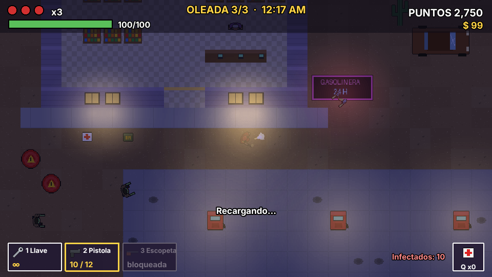

# Manual de usuario — Turno de Noche

*Gasolinera 24 h · Shooter 2D de supervivencia · Versión beta (Nivel 1)*

## 1. ¿De qué trata?

Eres **Marco Ruiz**, el empleado del turno nocturno de una gasolinera en el desierto de Sonora. A las 12:00 AM una pipa se voltea en la carretera y suelta una nube verde que convierte a la gente en infectados. Tu misión es **aguantar tres oleadas** defendiendo la tienda de **Doña Lupe** hasta que llegue la ayuda.

## 2. Cómo empezar

**En línea:** abre <https://joseortega8.github.io/turno-de-noche/> en Chrome o Firefox de escritorio.

**En tu computadora:**
1. Instala Visual Studio Code con la extensión **Live Server**.
2. Abre la carpeta del juego y da clic en **Go Live**.
3. No abras `index.html` con doble clic: el juego necesita un servidor local para cargar el mapa y los sonidos.

**Requisitos:** navegador moderno con WebGL 2, teclado y mouse, 8 GB de RAM y gráficos integrados.

## 3. Controles

| Tecla | Acción |
|---|---|
| **W A S D** | Moverse (velocidad constante, también en diagonal) |
| **Mouse** | Apuntar: Marco gira hacia el cursor |
| **Clic izquierdo** | Atacar con la llave o disparar (mantener presionado = disparo continuo) |
| **R** | Recargar (tarda 1 segundo) |
| **1 · 2 · 3** o **rueda del mouse** | Cambiar de arma |
| **Q** | Usar un botiquín (+30 de salud) |
| **E** | Abrir la tienda cuando estás junto a Doña Lupe |
| **Esc** o **P** | Pausa |
| **M** | Silenciar o activar el audio |

## 4. Pantallas

**Menú:** **JUGAR** (o Enter) empieza la partida y **CONTROLES** muestra la tabla anterior.

**Introducción:** cinco cuadros con el inicio de la historia. Clic o Espacio avanza y Esc la salta.

**HUD (pantalla de datos durante el juego):**

| Zona | Qué muestra |
|---|---|
| Arriba a la izquierda | Vidas (círculos rojos) y barra de salud |
| Arriba al centro | Oleada actual, hora de la noche y cuenta regresiva para la siguiente oleada |
| Arriba a la derecha | Puntos y pesos ($) |
| Abajo a la izquierda | Armas: la marcada en amarillo es la actual; se ve cargador / reserva |
| Abajo a la derecha | Infectados que faltan y botiquines guardados |
| Centro | Avisos: «Oleada 2», «[E] Abrir tienda», «Sin balas · R para recargar», etc. |

**Pausa:** Continuar, Reiniciar nivel o Volver al menú.

**Game Over / Victoria:** muestran el desglose del puntaje y el rango (S, A, B, C o D).

## 5. Cómo se juega

### Oleadas

| Oleada | Entradas | Infectados |
|---|---|---|
| 1 | E1 (izquierda) | 6 caminantes |
| 2 | E1 y E2 (derecha) | 5 caminantes + 3 corredores |
| 3 | E1, E2 y E3 (arriba) | 6 caminantes + 3 corredores + 1 hinchado |

- Al inicio tienes 5 segundos antes de la primera oleada.
- Las entradas activas parpadean en rojo cuando empieza cada oleada.
- La siguiente oleada no empieza hasta que eliminas a todos los infectados de la actual.
- Entre oleadas hay 15 segundos de descanso para ir a la tienda. Al cerrar la tienda la siguiente oleada empieza en 5 segundos.

### Infectados

| Infectado | Salud | Daño | Cómo se comporta | Pesos |
|---|---|---|---|---|
| **Caminante** | 30 | 10 | Lento; te persigue y rodea los obstáculos | $5 |
| **Corredor** | 15 | 8 | Muy rápido; después de golpearte se queda quieto medio segundo | $8 |
| **Hinchado** | 60 | 10 | Muy lento y resistente; al morir parpadea y **explota** (15 de daño en 80 px) | $15 |

### Armas

| Arma | Daño | Cadencia | Munición | Cómo se obtiene |
|---|---|---|---|---|
| **Llave inglesa** | 15 | 1.5 golpes/s | Ilimitada | Desde el inicio; golpea en un arco frente a Marco |
| **Pistola 9 mm** | 10 | 3 disparos/s | Cargador 12, reserva máx. 60 | Doña Lupe te la da al terminar la oleada 1 |
| **Escopeta** | 8 × 5 perdigones | 1 disparo/s | Cargador 6, reserva máx. 24 | Nivel 2 (versión completa) |

Sin balas en el cargador suena un clic y no dispara: presiona **R**.

### Objetos del mapa

- **Barriles rojos:** explotan si les disparas. Hacen 40 de daño a los infectados y 20 a Marco a 80 px. Pueden explotar en cadena. Atrae a los infectados hacia ellos y dispara de lejos.
- **Caja de munición (verde):** +12 balas de pistola. Reaparece en cada oleada.
- **Botiquín (blanco):** se guarda (máximo 2) o te cura si ya tienes 2.
- **Bombas de gasolina, autos y cactus:** sirven de obstáculo y cobertura.

### Tienda de Doña Lupe

Entre oleadas, entra a la tienda, acércate al mostrador y presiona **E**. El nivel se pausa mientras compras (con 1-4 o con el botón **Comprar**).

| Artículo | Precio | Regla |
|---|---|---|
| Balas de pistola (12) | $20 | La reserva no puede pasar de 60 |
| Cartuchos de escopeta (6) | $30 | Solo con escopeta (Nivel 2) |
| Botiquín (+30 de salud) | $25 | Máximo 2 guardados |
| Barrera de tablas | $40 | Bloquea durante la siguiente oleada la entrada más cercana a Marco |

Si no te alcanza, el botón se ve gris y suena un tono de error. Gastar pesos **no** baja tu puntaje.

### Vidas

- Empiezas con **3 vidas** y 100 de salud.
- Cada golpe te deja 1 segundo invulnerable (Marco parpadea).
- Si la salud llega a 0 pierdes una vida: reapareces frente a la tienda con 100 de salud, conservas armas, munición y pesos, y la oleada en curso se reinicia.
- Cada 10 000 puntos ganas una vida extra (máximo 5).
- Con 0 vidas aparece **Game Over**: puedes reintentar el nivel o volver al menú.

### Puntaje

| Evento | Puntos |
|---|---|
| Caminante / Corredor / Hinchado | +100 / +150 / +250 |
| Infectado eliminado por un barril | +50 extra |
| Superar la oleada N | +200 × N |
| Oleada sin recibir daño | +300 |
| Completar el nivel | +500 |
| Bono de tiempo | +2 por cada segundo por debajo de 300 s |
| Recibir un golpe | −50 |
| Perder una vida | −500 |

Rangos: **S** 12 000 o más · **A** 9 000 · **B** 6 000 · **C** 3 000 · **D** menos de 3 000 (pensados para los tres niveles).

## 6. Consejos

- En la oleada 1 solo tienes la llave: pega y retrocede, porque los caminantes tardan en alcanzarte.
- Usa los barriles de la izquierda contra los grupos que entran por E1.
- Al hinchado mátalo de lejos con la pistola.
- Compra balas antes de la oleada 3 y guarda un botiquín.

## 7. Solución de problemas

| Problema | Solución |
|---|---|
| Pantalla negra o no carga | Ábrelo con Live Server o desde GitHub Pages, no con doble clic |
| No hay sonido | Haz clic en la página (el navegador bloquea el audio hasta que interactúas) y revisa que no esté silenciado con M |
| Se ve borroso o muy chico | El juego se ajusta a la ventana; usa pantalla completa con F11 |

## 8. Créditos

Luis Angel Andrade Silva · Jose Carlos Calles Ortega · Federico Antonio Gutierrez Amaya · Jose Ramon Ibarra Fontes
Maestro: Iván Chenoweth · Creación de Videojuegos · Grupo 10-2 · Universidad Tecnológica de Hermosillo
Motor: Phaser 4.2.1 (licencia MIT).
